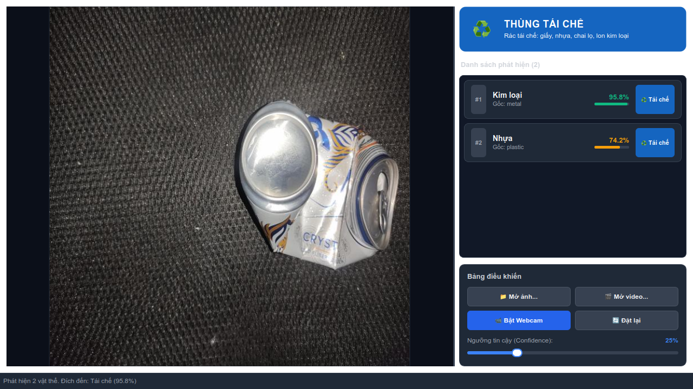

# Trash-Net — Hệ Thống Phân Loại Rác Thông Minh Thời Gian Thực

[](https://www.python.org/)
[](https://riverbankcomputing.com/software/pyqt/)
[](https://github.com/ultralytics/ultralytics)
[](tests/)

Trash-Net là ứng dụng phân loại rác thời gian thực ứng dụng thị giác máy tính và trí tuệ nhân tạo biên (Edge AI), được xây dựng trên nền tảng **YOLO11n-seg** và **PyQt6**. Ứng dụng tự động phân đoạn thực thể (Instance Segmentation), nhận diện 8 lớp rác thải phổ biến, quy hoạch trực tiếp vào 3 nhóm thùng rác tiêu chuẩn và phát hiện các rác thải bất thường hoặc nguy hại.

---

## 📸 Giao Diện Ứng Dụng



---

## 🌟 Tính Năng Nổi Bật

- **Phân đoạn thực thể tức thời (Real-time Instance Segmentation)**: Ứng dụng mô hình YOLO11n-seg gọn nhẹ (~6.2 MB), trích xuất chính xác đường biên đa giác (polygon contours) và nhãn không cắt mép màn hình.
- **Phân loại 8 lớp vào 3 thùng rác quy chuẩn**:
  - 🟢 **Tái chế (Recyclable)**: Chai nhựa (*plastic_bottle*), Ly nhựa (*plastic_cup*), Hộp xốp (*plastic_box*), Giấy/Bìa (*paper_cardboard*), Lon nhôm (*can*).
  - 🟠 **Hữu cơ (Organic)**: Rác thực phẩm, hữu cơ (*organic_waste*).
  - ⚪ **Vô cơ / Rác khác (Non-recyclable / Other)**: Túi nilon/Màng mỏng (*plastic_film*), Vải/Khác (*other*).
- **Làm mượt chuỗi thời gian & Chống nhấp nháy (Temporal Smoothing)**: Theo dõi bám vết đối tượng theo thời gian thực (IoU Tracker), bộ đệm trượt 30 khung hình kết hợp bỏ phiếu đa số có trọng số, đảm bảo nhãn chỉ cập nhật khi phát hiện ổn định đủ 1.5 giây.
- **Cảnh báo ngoài phân phối (OOD) & Gắn cờ rác nguy hại**:
  - Tự động nhận diện trường hợp độ tin cậy thấp hoặc dự đoán phân tán, chuyển trạng thái "Không chắc chắn — cần kiểm tra thủ công".
  - Cho phép người dùng gắn cờ vật thể nguy hại (pin, rác thải điện tử), tự động lưu trữ khung hình và tệp siêu dữ liệu `.json` vào thư mục `flagged/`.
- **Thanh trượt ngưỡng tin cậy linh hoạt**: Điều chỉnh tức thì ngưỡng phát hiện [0.10 – 0.95] (bước 0.05) và tự động ghi nhớ cấu hình qua `QSettings`.
- **Thẻ chỉ dẫn sơ chế rác (Guidelines Card)**: Cung cấp khuyến nghị trực quan bằng tiếng Việt cho từng loại rác, hỗ trợ chuẩn hóa quy trình tái chế theo `config/guidelines.yaml`.
- **Nhật ký phiên & Xuất báo cáo CSV**: Bảng thống kê theo dõi số lượng phân loại theo từng thùng rác, hỗ trợ xuất tệp CSV mã hóa UTF-8 with BOM mở trực tiếp trên Microsoft Excel / LibreOffice.

---

## 💻 Yêu Cầu Hệ Thống

- **Hệ điều hành**: Linux (Ubuntu 20.04+, Arch Linux, Fedora,...), macOS 12+, hoặc Windows 10/11.
- **Python**: Phiên bản `>= 3.10` (khuyến nghị Python 3.11 hoặc 3.12).
- **Thiết bị ngoại vi**: Camera/Webcam chuẩn USB hoặc tích hợp (hỗ trợ driver V4L2 trên Linux).
- **Phần cứng**:
  - CPU: Tối thiểu 4 nhân (x86_64 hoặc ARM64).
  - RAM: Tối thiểu 4 GB (khuyến nghị 8 GB).
  - GPU (Tùy chọn): GPU NVIDIA hỗ trợ CUDA để tăng tốc suy luận YOLO.

---

## 🚀 Khởi Chạy Nhanh 1-Dòng (Quick Start)

Dự án cung cấp kịch bản khởi chạy tự động chuẩn hóa môi trường:

```bash
./run.sh
```

> **Cơ chế hoạt động của `run.sh`**:
> 1. Tự động kiểm tra và khởi tạo môi trường ảo Python (`.venv`) nếu chưa có.
> 2. Tự động cài đặt/nâng cấp các gói phụ thuộc từ `requirements.txt`.
> 3. Kiểm tra tệp trọng số `models/yolo11n-seg.pt`.
> 4. Khởi chạy ứng dụng qua điểm vào gói chuẩn hóa `python -m trashnet`.

---

## 🛠️ Cài Đặt Thủ Công Từng Bước

Nếu muốn quản lý môi trường thủ công:

### 1. Chuẩn bị môi trường ảo

```bash
# Tạo môi trường ảo
python3 -m venv .venv

# Kích hoạt môi trường ảo
# Trên Linux/macOS:
source .venv/bin/activate
# Trên Windows:
# .venv\Scripts\activate
```

### 2. Cài đặt các thư viện phụ thuộc

```bash
# Nâng cấp pip
pip install --upgrade pip

# Cài đặt thư viện vận hành ứng dụng (Production dependencies)
pip install -r requirements.txt

# (Tùy chọn) Cài đặt thêm công cụ phát triển & kiểm thử (Development dependencies)
pip install -r requirements-dev.txt
```

### 3. Chuẩn bị tệp trọng số mô hình

Tải hoặc đặt tệp trọng số `yolo11n-seg.pt` vào thư mục `models/`:
```bash
# Vị trí tệp trọng số tiêu chuẩn:
models/yolo11n-seg.pt
```
*(Nếu chưa có trọng số phân đoạn tùy biến, ứng dụng sẽ tự động tải trọng số mẫu từ Ultralytics hoặc khởi động ở chế độ chờ).*

### 4. Khởi chạy ứng dụng

```bash
# Cách 1: Khởi chạy chuẩn module Python
python -m trashnet

# Cách 2: Khởi chạy qua main.py
python main.py
```

---

## 📂 Cấu Trúc Dự Án (Modular Architecture)

Dự án tuân thủ nghiêm ngặt mô hình kiến trúc mô-đun 7 phân vùng chức năng:

```text
trash-Net/
├── ui/                     # Tầng giao diện đồ họa PyQt6 & Worker luồng nền
│   ├── main_window.py      # Cửa sổ chính tích hợp và điều phối ứng dụng
│   ├── worker.py           # Luồng nền suy luận AI bất đồng bộ (InferenceWorker)
│   ├── qt_compat.py        # Lớp tương thích đồ họa PyQt6 / PySide6
│   └── widgets/            # Các thành phần giao diện chuyên biệt
│       ├── camera_view.py  # Hiển thị khung hình camera và vẽ overlay phân đoạn
│       ├── bin_card.py     # Thẻ hiển thị thùng rác đích lớn trực quan
│       ├── guideline_card.py # Thẻ hiển thị hướng dẫn sơ chế rác theo lớp
│       └── audit_dialog.py # Bảng xem nhật ký kiểm toán và xuất báo cáo CSV
├── core/                   # Tầng nghiệp vụ lõi (Decoupled Core, 100% không phụ thuộc GUI)
│   ├── detector.py         # Bộ suy luận YOLO11n-seg và giải mã đa giác
│   ├── smoother.py         # Thuật toán làm mượt chuỗi thời gian & IoU Tracker
│   ├── ood.py              # Bộ kiểm định phát hiện ngoài phân phối (OOD)
│   ├── flagging.py         # Quản lý gắn cờ rác nguy hại & ghi siêu dữ liệu JSON
│   ├── audit_log.py        # Quản lý nhật ký phiên kiểm toán & xuất CSV có BOM
│   ├── guidelines.py       # Trình nạp và tra cứu chỉ dẫn sơ chế rác
│   ├── mapper.py           # Quy tắc ánh xạ 8 lớp rác vào 3 nhóm thùng
│   └── types.py            # Định nghĩa các kiểu dữ liệu lõi (Enums, Dataclasses)
├── models/                 # Thư mục lưu trữ trọng số mạng nơ-ron (.pt)
│   ├── README.md           # Hướng dẫn định dạng và chuẩn bị trọng số
│   └── yolo11n-seg.pt      # Tệp trọng số mô hình phân đoạn thực thể
├── config/                 # Các tệp cấu hình tham số hệ thống
│   ├── bin_mapping.yaml    # Bảng ánh xạ lớp sang thùng rác
│   └── guidelines.yaml     # Nội dung hướng dẫn xử lý rác thải tiếng Việt
├── scripts/                # Kịch bản kiểm chuẩn và tiện ích độc lập
│   ├── audit_dataset.py    # Kiểm định phân bố nhãn dữ liệu MultiTrash
│   └── benchmark.py        # Đo kiểm chuẩn FPS và độ trễ suy luận AI
├── tests/                  # Bộ kiểm thử tự động hóa toàn diện (Headless Pytest)
│   ├── conftest.py         # Fixtures dùng chung cho kiểm thử
│   ├── test_detector.py    # Kiểm thử bộ suy luận và bọc biên
│   ├── test_smoother.py    # Kiểm thử bộ lọc làm mượt chuỗi thời gian
│   ├── test_ood.py         # Kiểm thử phân biệt OOD và cờ rác nguy hại
│   ├── test_audit_log.py   # Kiểm thử nhật ký phiên và xuất CSV UTF-8
│   ├── test_guidelines.py  # Kiểm thử nội dung sơ chế rác
│   └── test_structure.py   # Kiểm định tính độc lập kiến trúc mô-đun
├── reports/                # Báo cáo kiểm chuẩn, ma trận phân bố và ảnh preview
│   └── ui_preview.png      # Ảnh chụp màn hình giao diện thực tế
├── run.sh                  # Kịch bản khởi chạy 1-dòng tự động hóa
├── pyproject.toml          # Khai báo gói dự án PEP 517/621 & console scripts
├── requirements.txt        # Phiên bản thư viện vận hành cố định
└── requirements-dev.txt    # Thư viện kiểm thử và phát triển
```

---

## 🧪 Kiểm Thử Tự Động Hóa (Testing)

Toàn bộ tầng tính toán cốt lõi (`core/`) được thiết kế tách biệt hoàn toàn khỏi giao diện đồ họa, cho phép chạy kiểm thử trơn tru trên môi trường máy chủ hoặc CI/CD không có màn hình:

```bash
# Kiểm tra định dạng và chất lượng mã nguồn bằng Ruff
ruff check --no-cache core/

# Kiểm tra kiểu dữ liệu tĩnh bằng Mypy
mypy core/

# Chạy toàn bộ 88 bài kiểm thử tự động (Headless offscreen)
QT_QPA_PLATFORM=offscreen pytest tests/

# Chạy kiểm thử có hiển thị chi tiết tên từng ca kiểm thử
pytest -v tests/
```

---

## 🔧 Xử Lý Sự Cố Thường Gặp (Troubleshooting)

### 1. Lỗi quyền truy cập Camera trên Linux (`/dev/video*`)
- **Hiện tượng**: Không thể mở webcam, thông báo `Cannot open camera` hoặc lỗi cấp quyền thiết bị.
- **Khắc phục**:
  1. Kiểm tra danh sách camera có sẵn:
     ```bash
     v4l2-ctl --list-devices
     # hoặc kiểm tra thiết bị video:
     ls -la /dev/video*
     ```
  2. Thêm tài khoản người dùng hiện tại vào nhóm `video`:
     ```bash
     sudo usermod -aG video $USER
     ```
  3. Đăng xuất và đăng nhập lại hệ điều hành để quyền mới có hiệu lực.

### 2. Lỗi thiếu thư viện đồ họa Qt/xcb (`Could not load the Qt platform plugin "xcb"`)
- **Hiện tượng**: Ứng dụng báo lỗi thiếu plugin `xcb` hoặc `libxcb-cursor0` khi khởi động trên Linux.
- **Khắc phục**:
  - Trên **Ubuntu/Debian**:
    ```bash
    sudo apt update
    sudo apt install -y libxcb-cursor0 libxkbcommon-x11-0 libxcb-icccm4 libxcb-image0 libxcb-keysyms1 libxcb-randr0 libxcb-render-util0 libxcb-shape0 libxcb-xfixes0
    ```
  - Trên **Arch Linux / Manjaro**:
    ```bash
    sudo pacman -S --needed libxcb xcb-util-cursor libxkbcommon-x11
    ```
  - Trên **Fedora / RHEL**:
    ```bash
    sudo dnf install xcb-util-cursor libxkbcommon-x11
    ```

### 3. Vận hành trên môi trường hiển thị Wayland
- **Khắc phục**: Nếu giao diện gặp hiện tượng giật hình hoặc không mở được trên Wayland, chạy với tùy biến nền tảng:
  ```bash
  # Ép chạy chế độ Wayland thuần:
  QT_QPA_PLATFORM=wayland python -m trashnet

  # Hoặc ép chạy qua lớp tương thích XWayland (xcb):
  QT_QPA_PLATFORM=xcb python -m trashnet
  ```

### 4. Xung đột giữa `opencv-python` và `PyQt6`
- **Nguyên nhân**: Bản `opencv-python` mặc định có chứa các thư viện Qt nhúng sẵn, dễ gây xung đột ký hiệu (symbol collision) với `PyQt6`.
- **Khắc phục**: Dự án đã cố định việc sử dụng `opencv-python-headless` trong `requirements.txt`. Đảm bảo bạn đã gỡ bỏ bản OpenCV đồ họa thông thường:
  ```bash
  pip uninstall -y opencv-python opencv-contrib-python
  pip install opencv-python-headless
  ```

---

## 📜 Giấy Phép & Đóng Góp

Dự án được phân phối dưới giấy phép mã nguồn mở MIT. Mọi đóng góp cải tiến thuật toán, tinh chỉnh nhãn dữ liệu hoặc giao diện người dùng đều được hoan nghênh qua Pull Requests!
